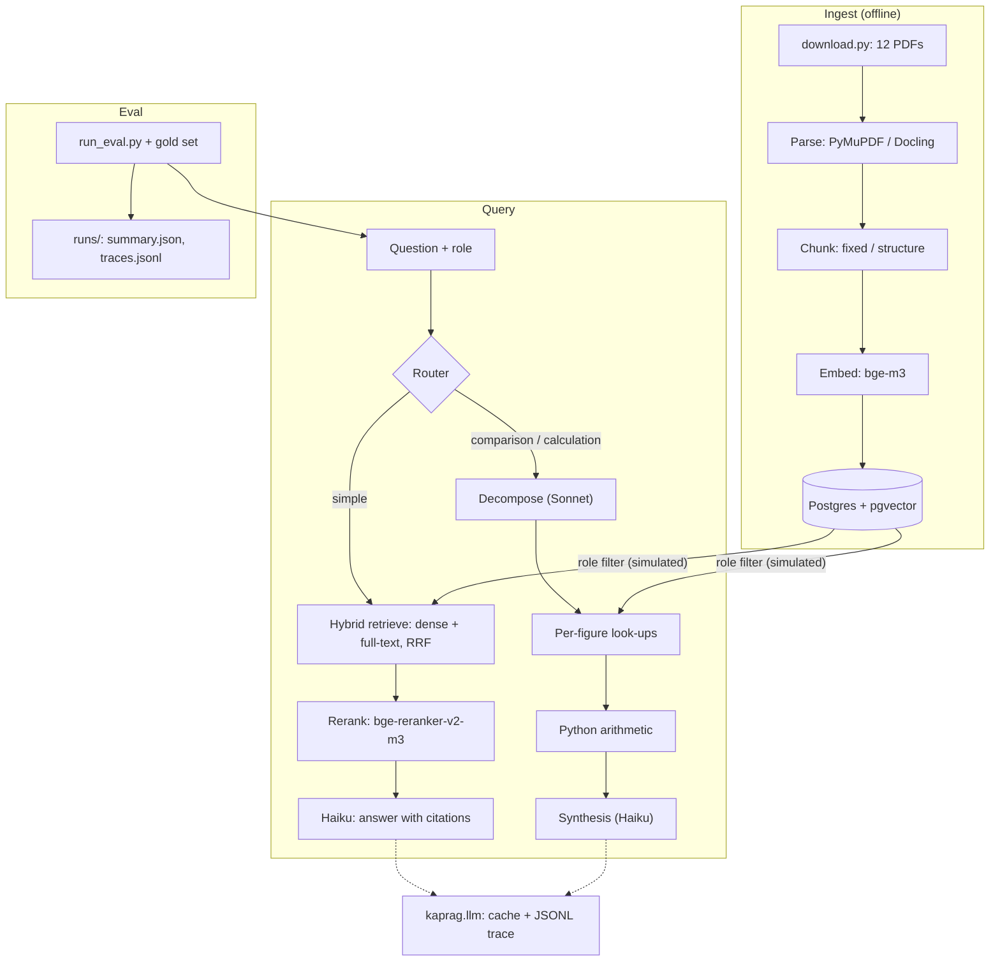

# kaprag

English · [Türkçe](README.md)

A document assistant that answers Turkish questions with page citations, over the 2023–2025 integrated annual reports of four Turkish banks. The main output of the project is not the assistant itself but **measurement**: an ablation table showing what each architectural change does to quality, cost and latency (currently a draft on an unverified gold set — see [Results](#results)).

## Problem

Bank annual reports are PDFs of several hundred pages; most figures sit in tables, footnotes and two-column spreads. To answer a question such as "By what percentage did Yapı Kredi's net profit change from 2024 to 2025?" a system has to find the right report, the right page and the right figure, compute if needed, and decline to answer when the information is not there. Whether a change that is supposed to make a RAG system "better" actually helps can only be known by measuring it.

## What was built

- **Corpus:** the 2023, 2024 and 2025 integrated annual reports of Garanti BBVA, Akbank, Türkiye İş Bankası and Yapı Kredi — 12 PDFs, 3,187 pages. The PDFs are not in the repository; a script downloads them from the addresses in `data/manifest.csv` (the banks' investor-relations sites). Garanti's reports do not contain the full statutory financial statements; the other three banks' reports do.
- **Parsing:** PyMuPDF (page text) and Docling on the GPU (headings, Markdown tables, text inside pictures). The full Docling run took 95.6 min on an RTX 3050 Laptop (4 GB VRAM): 1.90 s per page, peak 1.56 GB VRAM (`runs/2026-11-17-docling-full/`).
- **Index:** Postgres 17 + pgvector, bge-m3 (1024-d), HNSW and Turkish full-text search (GIN). Two variants: `chunks_fixed` with 10,488 chunks (~500 tokens, 50 overlap) and the Docling structure-aware `chunks_structure` with 25,864 chunks (text 16,097 / table 9,073 / picture text 694) (`runs/2026-11-17-index-build/`).
- **Query side:** hybrid search (dense + Turkish full-text, fused with RRF), reranking with bge-reranker-v2-m3, and an answer with citations from `claude-haiku-5-5`. A LangGraph router sends comparison and calculation questions down a separate path: `claude-sonnet-5-5` decomposes the question into look-ups, each figure is retrieved on its own, and the arithmetic is done in Python. There is no free tool-calling; if a figure is missing or units/bases disagree, the system abstains and names what is missing.
- **Eval:** a 243-question gold set, deterministic numeric scoring, an LLM judge for text answers, page-level retrieval metrics, cost and latency. Design: [`eval/README.md`](eval/README.md) (in Turkish).
- **Access control (simulated):** `public` / `analyst` / `risk` roles and a leak test — see below.
- **Interfaces:** a review app (Streamlit) for human verification of the gold set, a chat demo (Streamlit) and an `/ask` API (FastAPI).
- **LLM access:** every call goes through a thin `kaprag.llm` client with two backends: `claude_code` (the developer's Claude subscription via the Claude Agent SDK; the default for local development and eval) and `anthropic_api` (API key; for any demo exposed to others). Replies are cached on disk and every call is traced to JSONL. Run traces can be exported to Langfuse with `scripts/export_langfuse.py` (see the limitations below).

## Architecture



Package layout (`src/kaprag/`): `parsing`, `chunking`, `index`, `rag` (retrieval, rerank, generation), `agent` (router and calculation path), `access` (simulated roles), `llm`, `eval`, `gold` (gold set drafting), `serve` (API and demo service), `observability` (Langfuse export). Every experiment is a YAML file under `configs/`. `hybrid`, `rerank`, `structure` and `metadata_filter` are each a copy of the previous one with one block changed; `router` is built on `rerank` (fixed index), not on `metadata_filter`: simple questions go through the `rerank` pipeline unchanged.

## Results

> [!WARNING]
> **Draft — unverified gold set.** Every number below was measured on a 243-question gold set that was drafted by an LLM and of which **no question has been verified by a human yet** (questions with `verified: true`: 0). Under the eval design ([`eval/README.md`](eval/README.md) §6) only numbers from the human-verified subset belong in the README or a CV; these tables are a labelled draft and will be replaced as questions are verified in the review app. The judge that grades text answers (`claude-sonnet-5-5`) is from the same model family as the generator (`claude-haiku-5-5`) and has not yet been calibrated against human labels.

Gold set: 243 questions — olgusal (factual) 39, tablo (table) 60, hesaplama (calculation) 26, karsilastirma (comparison) 39, sentez (synthesis) 26, cevapsiz (unanswerable) 33, belirsiz (ambiguous) 20. Split: dev 84 / test 159 (30 pilot questions inside dev). Numeric answers are scored deterministically, without a judge. Component metric definitions: [`eval/README.md`](eval/README.md) §6.

**Answer accuracy** is the mean per-question score (not simply the share of correct answers): `abstain` and `clarify` questions score 1 if the system behaved as expected, else 0; questions that expect an answer (`answer`, `answer_with_assumption`) score 0 if the behaviour check fails, otherwise their content score — numeric correctness (1/0), the judge's verdict (1/0) or, for `sentez`, the fraction of key points covered. A question whose pipeline failed scores 0; a question with a missing judge verdict is excluded from the mean and the count is reported. Definition: [`src/kaprag/eval/metrics.py`](src/kaprag/eval/metrics.py).

### Ablation — dev split (84 questions, 0 errors in every run) — draft, unverified gold set

| Config | What it adds | Answer accuracy | page_recall@5 | page_recall@10 | Citation precision | False-abstain rate | API-equivalent cost / question | p50 latency | Run folder |
|---|---|---|---|---|---|---|---|---|---|
| baseline | fixed chunks, dense search, top-5 context, Haiku | 0.455 | 0.581 | 0.770 | 0.37 | 0.500 | $0.0013 | 7.8 s | `runs/2026-11-17-baseline-dev/` |
| hybrid | + Turkish full-text search fused with RRF (k=60) | 0.499 | 0.689 | 0.770 | 0.47 | 0.455 | $0.0014 | 6.7 s | `runs/2026-11-17-hybrid-dev/` |
| rerank | + top-40 reranked by bge-reranker-v2-m3 | 0.592 | 0.811 | 0.919 | 0.46 | 0.364 | $0.0014 | 9.5 s | `runs/2026-11-17-rerank-dev/` |
| structure | + Docling structure-aware index instead of fixed chunks | 0.567 | 0.730 | 0.770 | 0.74 | 0.333 | $0.0012 | 7.9 s | `runs/2026-11-17-structure-dev/` |
| metadata_filter | + bank/year SQL filter parsed from the question by Haiku | 0.575 | 0.770 | 0.838 | 0.67 | 0.333 | $0.0013 | 10.3 s | `runs/2026-11-17-metadata-filter-dev/` |
| router | LangGraph: simple questions → `rerank`; comparison/calculation → decompose (Sonnet) → per-figure look-ups → Python arithmetic → synthesis | 0.651 | 0.905 | 0.932 | 0.43 | 0.197 | $0.0045 | not comparable (see note) | `runs/2026-11-17-router-dev/` |

Answer accuracy by question type (dev; number of questions in parentheses):

| Config | `olgusal` (13) | `tablo` (22) | `hesaplama` (9) | `karsilastirma` (13) | `sentez` (9) | `cevapsiz` (12) | `belirsiz` (6) |
|---|---|---|---|---|---|---|---|
| baseline | 0.69 | 0.41 | 0.11 | 0.08 | 0.36 | 1.00 | 0.50 |
| hybrid | 0.77 | 0.45 | 0.00 | 0.08 | 0.43 | 1.00 | 0.83 |
| rerank | 0.77 | 0.55 | 0.11 | 0.31 | 0.63 | 1.00 | 0.83 |
| structure | 0.85 | 0.41 | 0.11 | 0.38 | 0.52 | 1.00 | 0.83 |
| metadata_filter | 0.85 | 0.45 | 0.11 | 0.38 | 0.48 | 1.00 | 0.83 |
| router | 0.77 | 0.55 | 0.33 | 0.54 | 0.63 | 1.00 | 0.83 |

Reading the table:

- **Noise:** with n = 84 the standard error of one proportion is about 5 points. Differences of 1–3 points between rerank / structure / metadata_filter are within noise. The larger steps are baseline → rerank (≈14 points) and rerank → router (≈6 points, close to the standard error; concentrated in the two targeted types, calculation and comparison). The router's simple-route answers are identical to `rerank`, so the difference comes only from the routed comparison/calculation questions. By-type cells rest on 6–22 questions on dev and 14–38 on test.
- **Correct abstention** has no separate column in the dev table; the `cevapsiz` column shows it (1.00 in every dev run).
- **structure** did not improve answer accuracy; it clearly improved citation precision (its chunks are single-page). Part of its lower page recall may be a measurement effect: fixed chunks span several pages and meet the "gold page within the chunk's page span" rule more easily. This was not verified.
- **Router page recall:** on multi-route questions it is computed over an interleaved union of the per-look-up lists, each filtered by the plan's bank and year, so it is not like-for-like with the single-query rows.
- **Latency** is wall time per question at concurrency 4, including waits on the retriever lock and the LLM concurrency limit. It excludes questions with a cached LLM call. Router dev latency could be measured on only 9 questions (the simple-route answers were cache hits from the `rerank` run), mostly agent-route ones: p50 25.0 s — not comparable to the other rows; use the test-split latency for the router.
- **Cost** is "API-equivalent": tokens × API list price (Haiku 5.5 $0.10 / $0.50, Sonnet 5.5 $2 / $10 per 1M input/output tokens). Development ran on a Claude subscription, which shows no dollars. Judge cost is excluded from cost per question.
- The optional step T9e (swapping the embedding model for multilingual-e5-large) was not run.

### Test split — run once (159 questions, 0 errors) — draft, unverified gold set

| Config | Answer accuracy | Numeric accuracy | page_recall@5 | page_recall@10 | Correct-abstain rate | False-abstain rate | Cost / question | p50 / p95 latency | Run folder |
|---|---|---|---|---|---|---|---|---|---|
| baseline | 0.478 | 0.373 | 0.604 | 0.709 | 1.00 | 0.435 | $0.0014 | 6.4 s / 12.7 s | `runs/2026-11-17-baseline-test/` |
| router (best on dev) | 0.664 | 0.508 | 0.813 | 0.896 | 1.00 | 0.137 | $0.0047 | 12.0 s / 25.7 s | `runs/2026-11-17-router-test/` |

Answer accuracy by question type (test; same run folders):

| Config | `olgusal` (26) | `tablo` (38) | `hesaplama` (17) | `karsilastirma` (26) | `sentez` (17) | `cevapsiz` (21) | `belirsiz` (14) |
|---|---|---|---|---|---|---|---|
| baseline | 0.69 | 0.37 | 0.29 | 0.00 | 0.35 | 1.00 | 0.86 |
| router | 0.81 | 0.42 | 0.65 | 0.56 | 0.53 | 1.00 | 0.93 |

For one router question (q127) the judge call returned invalid JSON; it is excluded from answer accuracy (n = 158). Router latency was measured on 130 questions (29 had a cached sub-call).

### Access control (simulated) and leak test

The annual reports used here are public documents; the access model is **simulated**, only to demonstrate the mechanism. Roles are assigned to chunks by a fixed rule: content under a "Risk Yönetimi" (risk management) heading → `risk` only; section five (footnotes) of the statutory financial report → `analyst` and `risk`; everything else → `public`.

- Share of chunks: `chunks_fixed` 61.8% public / 10.3% analyst+risk / 27.9% risk; `chunks_structure` 56.5% / 16.7% / 26.8% (`runs/2026-11-17-acl-assign/`). Garanti's reports are only 3–8% restricted; the other nine are roughly 40–55% restricted. A demo with the `public` role therefore may not answer questions whose evidence lies in the risk-management sections or the financial-statement footnotes (not counted).
- The filter is a SQL condition applied before ranking in both the dense and the full-text arm; the role comes from the caller, never from the question text.
- Leak test (`eval/acl_leak.jsonl`): 30 adversarial queries as `public` (18 direct requests for restricted content, 12 prompt-injection / social-engineering attempts). A leak is any restricted chunk among the 40 retrieved items. Result: 0/30 on the fixed index (`runs/2026-11-17-acl-leak-rerank-public/`) and 0/30 on the structure index (`runs/2026-11-17-acl-leak-structure-public/`). Positive control with the filter off: 30/30 queries retrieve restricted chunks.
- A real deployment would take roles and document entitlements from the organisation's identity provider and document-management ACLs at ingestion time, pass the authenticated user's role from the session rather than from the request text, and audit-log every retrieval. This project has no authentication, no enterprise ACL integration and no audit log.

### English questions (small probe) — draft, unverified gold set

English translations of 15 dev questions (`eval/gold/questions_en.jsonl`) were run with the router: answer score 0.720 in English vs 0.653 for the Turkish originals; page_recall@5 0.769 vs 0.846 (`runs/2026-11-17-router-english-probe/`). n = 15 is too small to call a difference; 6 of the 15 English questions were answered in Turkish. This run was made after the access roles were written to the index.

## Quick start (Windows and macOS)

Development was done on Windows 11 with an RTX 3050 Laptop GPU with 4 GB VRAM (the embedder and reranker resident together use about 2.6 GB). The code is written to run on Windows and macOS, but it has **not yet been tried on macOS**.

**Prerequisites**

- [uv](https://docs.astral.sh/uv/) (it manages the Python version; the project requires Python ≥ 3.11, `.python-version` is 3.11), Git, Docker Desktop.
- An NVIDIA GPU for the GPU steps (Docling, embedding, rerank): on Windows the `ml` group installs PyTorch from the CUDA 13.0 wheels. On macOS the lock file resolves the CPU/MPS PyTorch from PyPI; the GPU steps are untested there. On any machine without an NVIDIA GPU (not only macOS), the `device: cuda` values in `configs/*.yaml` and the scripts' `--device` flags must be changed before evaluation or the apps.
- For the `claude_code` backend: a Claude subscription and a one-time login with the Claude Code CLI on the machine. `ANTHROPIC_API_KEY` must **not** be set while this backend is used; if it is, usage is billed to the API instead of the subscription. For a demo exposed to others, use the `anthropic_api` backend with an API key.
- Clone the repository into a folder whose path has no non-ASCII characters (the path on the development machine contained `ş`, which required two workarounds).

**1. Dependencies and settings** (from the repository root)

```bash
uv sync --group ml --group app
```

`uv sync` installs the groups you name plus the default `dev` group and removes the others; if you also need the Langfuse export, add `--group observability` to the same command. `uv run` does not remove installed groups.

Windows (PowerShell):

```powershell
Copy-Item .env.example .env
Remove-Item Env:ANTHROPIC_API_KEY -ErrorAction SilentlyContinue
```

macOS (zsh):

```bash
cp .env.example .env
unset ANTHROPIC_API_KEY
```

`Remove-Item` / `unset` clears the variable for the current terminal session only; if it is set permanently, also remove it from the user or system environment variables. `.env` ships with `LLM_BACKEND=claude_code`. To test the LLM connection with a single call (`claude_code` backend; a second run is served from the cache):

```bash
uv run python scripts/smoke_llm.py
```

**2. Database**

```bash
docker compose up -d
```

This starts only the `db` service (Postgres 17 + pgvector on `localhost:5432`). The optional Langfuse stack starts with `docker compose --profile observability up -d` and needs the `LANGFUSE_*` variables in `.env`.

**3. Data and index**

```bash
uv run python scripts/download.py
uv run python scripts/download.py --verify
uv run python scripts/parse.py --parser pymupdf
uv run python scripts/parse.py --parser docling
uv run python scripts/build_index.py --variant fixed
uv run python scripts/build_index.py --variant structure
```

The Docling parse took about 95 minutes on the reference GPU (RTX 3050 Laptop). Both index variants need the Docling output (the access roles are computed from it). `parse.py` (Docling) and `build_index.py` default to `--device cuda`; on a machine without a GPU, `--device cpu` can be passed (untried, and it will be slow). A quick check:

```bash
uv run python scripts/search.py --variant fixed --mode fts "Akbank net kar 2024"
```

**4. Eval**

```bash
uv run python scripts/run_eval.py --config baseline --split dev
uv run python scripts/run_eval.py --config router --split dev
```

Each run writes `summary.json` and a per-question `traces.jsonl` under `runs/YYYY-MM-DD-<topic>/`. One `run_eval` makes at least one generator call per question (84 on dev), more for the router, plus judge calls; with the `claude_code` backend these count against the subscription quota. The configs use `device: cuda` (change it on a machine without a GPU, see Prerequisites). The test split is run only for important versions and requires `--confirm-test`. Gold set distribution: `uv run python scripts/gold_stats.py`.

**5. Apps** (all bind to `127.0.0.1` only; the chat demo and the API also use the `device: cuda` values under `configs/`)

```bash
uv run streamlit run scripts/review_app.py
uv run streamlit run scripts/chat_app.py
uv run python scripts/serve_api.py
```

- The review app shows the question and the PDF page side by side; `verified: true` is set only there, by the user.
- The chat demo uses the `router` config by default (change it with `-- --config rerank`) and lets you pick a role (simulated).
- The API runs at `http://127.0.0.1:8000`: `POST /ask` with the body `{"question": "...", "role": "public"}`; interactive docs at `http://127.0.0.1:8000/docs`. There is no authentication; it can be bound to a non-loopback address only with `--allow-public` and the `anthropic_api` backend.

**Tests and lint** (tests that need no GPU, database or LLM)

```bash
uv run ruff check .
uv run pytest -m "not gpu and not db and not llm"
```

A GitHub Actions workflow (`.github/workflows/ci.yml`) is defined to run the same two commands on Windows and macOS; it has **not yet run on GitHub**, because the repository has not been pushed.

## Limitations

- **Unverified gold set:** all 243 questions are LLM drafts; none has been verified by a human. Every number above is a draft.
- **Judge from the same family:** `claude-sonnet-5-5`, which grades text answers, is from the same model family as the generator `claude-haiku-5-5`; calibration against 50 human-labelled answers has not been done yet.
- **Simulated access control:** the reports are public; roles are assigned by a fixed rule, at page-level granularity.
- **Subscription backend in development:** development and eval ran on a Claude subscription (`claude_code`); costs are equivalents computed from API list prices. Anything exposed to others needs the `anthropic_api` backend.
- **Small dev set:** with 84 questions, small differences stay within noise.
- **Garanti:** its reports lack the full statutory financial statements (the other three banks' reports have them); the corpus is uneven in this respect.
- **Main failure source on the agent path:** extracting and normalising single figures.
- **Pooling bias:** the evidence pages in the gold set were completed partly with the same retrievers that are being evaluated.
- **Dev/test fact overlap:** the split is stratified by (type, bank) and ignores `derived_from`; 61 of the 159 test questions share a source single-fact question with a dev question, including 24 of the 26 test `karsilastirma` questions. Comparison and calculation are the router's target types and the router was chosen on dev, so for these types the test set is not fully held out. No sign of harm was found: no gold content is in any prompt or pipeline code, and the router's test accuracy is 0.59 on the overlapping questions against 0.71 on the rest.
- **Not yet done:** CI has not run on GitHub; the Langfuse exporter is unit-tested and dry-run-checked but has not been run against a real Langfuse server; nothing has been tried on macOS.

## Where the details live

- [`PLAN.md`](PLAN.md) — scope, architecture decisions, task status, decision log (in Turkish).
- [`eval/README.md`](eval/README.md) — question types, schema, scoring rules, metrics, gold set production (in Turkish).
- `configs/` — the configuration of each ablation step.
- [`CLAUDE.md`](CLAUDE.md) — working rules for this repository.
