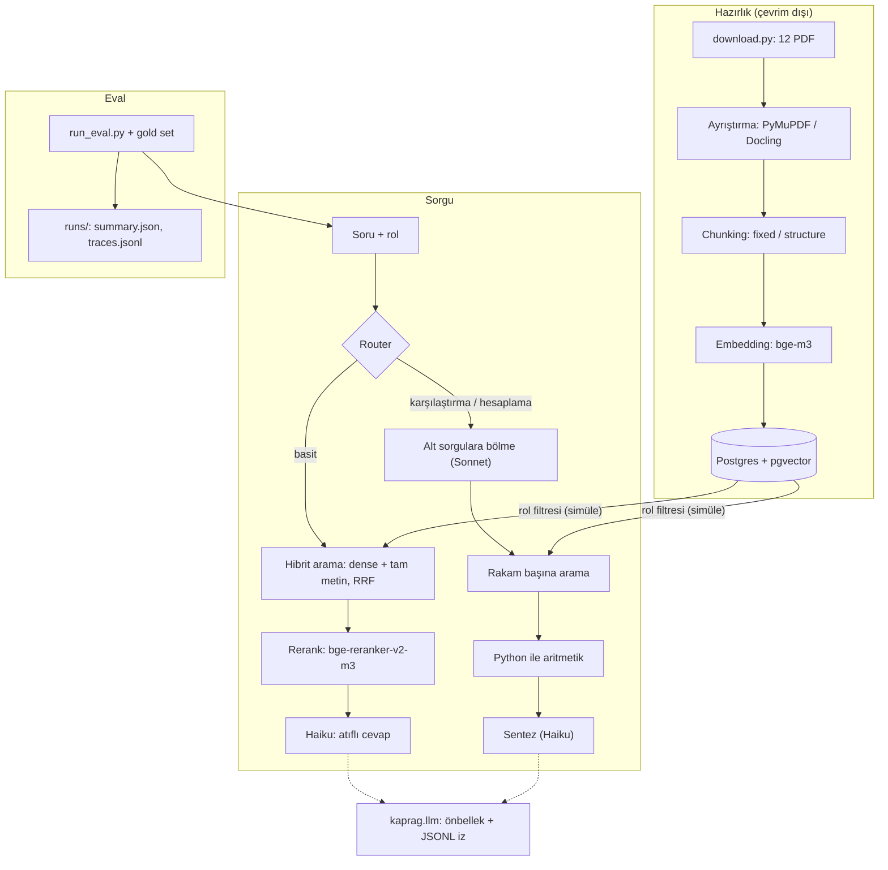

# kaprag

[English](README.en.md) · Türkçe

Dört Türk bankasının 2023–2025 entegre faaliyet raporları üzerinde çalışan, Türkçe soruya kaynak sayfası göstererek cevap veren bir doküman asistanı. Projenin asıl çıktısı asistanın kendisi değil, **ölçüm**: her mimari değişikliğin kaliteye, maliyete ve gecikmeye etkisini gösteren bir ablation tablosu (gold set LLM ile üretildi ve LLM ile denetlendi, insan denetimi yapılmadı — bkz. [Sonuçlar](#sonuçlar)).

## Sorun

Banka faaliyet raporları yüzlerce sayfalık PDF'lerdir; rakamların çoğu tablolarda, dipnotlarda ve iki sütunlu sayfa düzenlerinde durur. "Yapı Kredi'nin net kârı 2024'ten 2025'e yüzde kaç değişti?" gibi bir soruya doğru cevap vermek için doğru raporu, doğru sayfayı ve doğru rakamı bulmak, gerekiyorsa hesap yapmak ve bilgi yoksa cevap vermeyi reddetmek gerekir. Bir RAG sisteminde "daha iyi" olduğu iddia edilen her değişikliğin gerçekten işe yarayıp yaramadığı ancak ölçülerek anlaşılır.

## Ne yapıldı

- **Korpus:** Garanti BBVA, Akbank, Türkiye İş Bankası ve Yapı Kredi'nin 2023, 2024 ve 2025 entegre faaliyet raporları — 12 PDF, 3.187 sayfa. PDF'ler depoda yok; `data/manifest.csv` içindeki adreslerden (bankaların yatırımcı ilişkileri siteleri) bir script ile indirilir. Garanti'nin raporlarında yasal finansal tabloların tamamı yer almaz, diğer üç bankanınkinde yer alır.
- **Ayrıştırma:** PyMuPDF (sayfa metni) ve GPU üzerinde Docling (başlıklar, Markdown tablolar, görsel içindeki metin). Tam Docling koşusu RTX 3050 Laptop'ta (4 GB VRAM) 95,6 dakika sürdü: sayfa başına 1,90 sn, en yüksek 1,56 GB VRAM (`runs/2026-11-17-docling-full/`).
- **İndeks:** Postgres 17 + pgvector, bge-m3 (1024 boyut), HNSW ve Türkçe tam metin (GIN). İki varyant: `chunks_fixed` 10.488 chunk (~500 token, 50 örtüşme) ve Docling yapısına dayalı `chunks_structure` 25.864 chunk (metin 16.097 / tablo 9.073 / görsel metni 694) (`runs/2026-11-17-index-build/`).
- **Sorgu tarafı:** hibrit arama (dense + Türkçe tam metin, RRF ile birleştirme), bge-reranker-v2-m3 ile yeniden sıralama, `claude-haiku-5-5` ile atıflı cevap. LangGraph router karşılaştırma ve hesaplama sorularını ayrı bir yola gönderir: soru `claude-sonnet-5-5` ile alt sorgulara bölünür, her rakam ayrı aranır, aritmetik Python'da yapılır. Serbest tool-calling yok; bir rakam eksikse ya da birim/esas uyuşmuyorsa sistem cevap vermez ve neyin eksik olduğunu söyler.
- **Eval:** 240 soruluk gold set (LLM ile üretildi, bağımsız bir LLM denetiminden geçti), deterministik sayısal puanlama, metin cevapları için LLM judge, sayfa düzeyinde retrieval metrikleri, maliyet ve gecikme. Tasarım: [`eval/README.md`](eval/README.md).
- **Erişim kontrolü (simüle):** `public` / `analyst` / `risk` rolleri ve sızıntı testi — aşağıda.
- **Arayüzler:** gold set'in insan tarafından doğrulanması için review uygulaması (Streamlit), sohbet demosu (Streamlit) ve `/ask` API'si (FastAPI).
- **LLM erişimi:** bütün çağrılar ince bir `kaprag.llm` istemcisinden geçer; iki backend var: `claude_code` (geliştiricinin Claude aboneliği, Claude Agent SDK üzerinden; yerel geliştirme ve eval için varsayılan) ve `anthropic_api` (API anahtarı; başkalarına açılan her demo için). Cevaplar diskte önbelleğe alınır, her çağrı JSONL olarak izlenir. Run izleri `scripts/export_langfuse.py` ile Langfuse'a aktarılabilir (aşağıdaki sınırlamalara bakın).

## Mimari



Paket düzeni (`src/kaprag/`): `parsing`, `chunking`, `index`, `rag` (retrieval, rerank, üretim), `agent` (router ve hesaplama yolu), `access` (simüle roller), `llm`, `eval`, `gold` (gold set taslağı), `serve` (API ve demo servisi), `observability` (Langfuse aktarımı). Her deney `configs/` altındaki bir YAML dosyasıdır. `hybrid`, `rerank`, `structure` ve `metadata_filter` her biri bir öncekinin tek bloğu değiştirilmiş kopyasıdır; `router` ise `metadata_filter` üzerine değil, `rerank` üzerine (fixed indeks) kuruludur: basit sorular aynen `rerank` hattından geçer.

## Sonuçlar

**Gold set LLM ile üretildi ve bağımsız bir LLM denetiminden geçti; insan denetimi yapılmadı.** Bağımsız LLM agent'ları taslağı çıkarılmış 243 sorunun hepsini PDF sayfalarının görüntülerine (ve sayfa metnine) karşı denetledi: değer, ölçek/birim, konsolide/solo esas, yıl sütunu, sorunun kendi başına anlaşılırlığı, tekrarlar; türetilmiş soruların aritmetiği; `cevapsiz` sorular için korpus araması (`runs/2026-11-18-gold-audit/`). Sonuç: 224 soru geçti; 16 soru düzeltme gerektirdi — 13'ü düzeltildi, 3'ü insan tarafından yeniden yazılmak üzere işaretlendi; 3 soru reddedildi (2 tekrar, 1 raporda birbiriyle çelişen iki rakam). Ayrıca cevabı içermeyen 25 fazladan kanıt sayfası çıkarıldı. Ölçülen koşular yeniden çalıştırılmadı; kayıtlı çıktıları denetlenmiş gold dosyasına karşı yeniden puanlandı (`scripts/rescore_run.py`, `runs/<özgün>-rescored/` klasörleri; toplam 3 yeni judge çağrısı, gerisi judge önbelleğinden). Aşağıdaki sayılar **denetlenmiş alt kümenin** (`audit.status` `passed` ya da `fixed` olan 237 soru) sayılarıdır; insan tarafından doğrulanmış sayılar değildir — eval tasarımı ([`eval/README.md`](eval/README.md) §3, §6) "verified" sözcüğünü insan incelemesine ayırır ve `verified: true` olan soru sayısı 0'dır. Metin cevaplarını puanlayan judge (`claude-sonnet-5-5`) üretici modelle (`claude-haiku-5-5`) aynı aileden ve henüz insan etiketleriyle kalibre edilmedi.

Gold set: 240 soru — olgusal 39, tablo 57, hesaplama 26, karşılaştırma 39, sentez 26, cevapsız 33, belirsiz 20. Ayrım: dev 84 / test 156; denetlenmiş alt küme: dev 83 / test 154. Sayısal cevaplar judge olmadan, deterministik olarak puanlanır. Bileşen metriklerin tanımları: [`eval/README.md`](eval/README.md) §6. Tablolarda ondalık ayırıcı noktadır.

**Cevap doğruluğu**, soru başına puanların ortalamasıdır (yalnızca doğru cevapların payı değildir): `abstain` ve `clarify` soruları sistem beklenen davranışı gösterdiyse 1, göstermediyse 0 alır; cevap beklenen sorular (`answer`, `answer_with_assumption`) davranış kontrolünü geçemezse 0, geçerse içerik puanını alır — sayısal doğruluk (1/0), judge kararı (1/0) ya da `sentez` sorularında kapsanan key-point oranı. Pipeline'ı hata veren soru 0 sayılır; judge kararı eksik olan soru ortalamadan çıkarılır ve sayısı raporlanır. Tanım: [`src/kaprag/eval/metrics.py`](src/kaprag/eval/metrics.py).

### Ablation — dev split, denetlenmiş alt küme (83 soru; yeniden puanlandı, pipeline yeniden çalıştırılmadı)

| Konfigürasyon | Ne ekliyor | Cevap doğruluğu | page_recall@5 | page_recall@10 | Kaynak doğruluğu (precision) | Yanlış reddetme | Soru başına maliyet (API-eşdeğeri) | p50 gecikme | Run klasörü |
|---|---|---|---|---|---|---|---|---|---|
| baseline | fixed chunk, dense arama, top-5 bağlam, Haiku | 0.460 | 0.575 | 0.753 | 0.35 | 0.500 | $0.0013 | 7.8 sn | `runs/2026-11-17-baseline-dev-rescored/` |
| hybrid | + Türkçe tam metin arama, RRF (k=60) | 0.505 | 0.671 | 0.781 | 0.47 | 0.455 | $0.0014 | 6.6 sn | `runs/2026-11-17-hybrid-dev-rescored/` |
| rerank | + ilk 40 aday bge-reranker-v2-m3 ile yeniden sıralanır | 0.599 | 0.822 | 0.918 | 0.45 | 0.364 | $0.0014 | 9.5 sn | `runs/2026-11-17-rerank-dev-rescored/` |
| structure | + fixed chunk yerine Docling yapısına dayalı indeks | 0.574 | 0.726 | 0.767 | 0.70 | 0.333 | $0.0012 | 7.8 sn | `runs/2026-11-17-structure-dev-rescored/` |
| metadata_filter | + sorudan Haiku ile çıkarılan banka/yıl SQL filtresi | 0.582 | 0.767 | 0.822 | 0.63 | 0.333 | $0.0013 | 10.3 sn | `runs/2026-11-17-metadata-filter-dev-rescored/` |
| router | LangGraph: basit sorular → `rerank`; karşılaştırma/hesaplama → bölme (Sonnet) → rakam başına arama → Python aritmetiği → sentez | 0.659 | 0.918 | 0.945 | 0.43 | 0.197 | $0.0046 | karşılaştırılamaz (nota bakın) | `runs/2026-11-17-router-dev-rescored/` |

Tipe göre cevap doğruluğu (denetimden sonraki 84 dev sorusunun tamamı, işaretlenmiş 1 soru dahil; parantez içinde soru sayısı; aynı run klasörleri):

| Konfigürasyon | `olgusal` (13) | `tablo` (22) | `hesaplama` (9) | `karsilastirma` (13) | `sentez` (9) | `cevapsiz` (12) | `belirsiz` (6) |
|---|---|---|---|---|---|---|---|
| baseline | 0.69 | 0.41 | 0.11 | 0.08 | 0.36 | 1.00 | 0.50 |
| hybrid | 0.77 | 0.45 | 0.00 | 0.08 | 0.43 | 1.00 | 0.83 |
| rerank | 0.77 | 0.55 | 0.11 | 0.31 | 0.63 | 1.00 | 0.83 |
| structure | 0.85 | 0.41 | 0.11 | 0.38 | 0.52 | 1.00 | 0.83 |
| metadata_filter | 0.85 | 0.45 | 0.11 | 0.38 | 0.48 | 1.00 | 0.83 |
| router | 0.77 | 0.55 | 0.33 | 0.54 | 0.63 | 1.00 | 0.83 |

Tabloyu okurken:

- **Denetimin etkisi:** denetim dev'de cevap doğruluğunu her konfigürasyonda en fazla 0.01 değiştirdi; dev'deki düzeltmelerin neredeyse hepsi kanıt sayfası düzeltmesiydi ve bunlar cevap puanlarını değil, retrieval ve atıf metriklerini oynatır.
- **Gürültü:** n = 83'te tek bir oranın standart hatası yaklaşık 5 puandır. rerank / structure / metadata_filter arasındaki 1–3 puanlık farklar gürültü içindedir. Daha büyük adımlar baseline → rerank (≈14 puan) ve rerank → router'dır (≈6 puan, standart hataya yakın; artış hedeflenen iki tipte, hesaplama ve karşılaştırmada toplanıyor). Router'ın basit yoldaki cevapları `rerank` ile aynıdır; fark yalnızca yönlendirilen karşılaştırma/hesaplama sorularından gelir. Tipe göre hücreler dev'de 6–22, test'te 14–35 soruya dayanır.
- **Doğru reddetme** dev tablosunda ayrı sütun olarak yok; `cevapsiz` sütunu bunu gösterir (her dev koşusunda 1.00).
- **structure** cevap doğruluğunu artırmadı; kaynak doğruluğunu (precision) belirgin biçimde artırdı (chunk'ları tek sayfalık). Daha düşük page recall'unun bir kısmı ölçüm etkisi olabilir: fixed chunk'lar birkaç sayfaya yayıldığı için "gold sayfa chunk'ın sayfa aralığında" kuralını daha kolay karşılar. Bu doğrulanmadı.
- **Router'ın page recall'u:** çok adımlı yoldaki sorularda, her biri planın banka ve yılına göre filtrelenmiş alt sorgu listelerinin sırayla harmanlanmış birleşimi üzerinden hesaplanır; bu yüzden tek sorgulu satırlarla birebir karşılaştırılamaz.
- **Gecikme** soru başına, eşzamanlılık 4'te ölçülen gerçek süredir; retriever kilidinde ve LLM eşzamanlılık sınırında beklenen süre de buna dahildir. Önbellekten gelen LLM çağrısı içeren soruları dışarıda bırakır. Router'ın dev gecikmesi yalnızca 9 soruda ölçülebildi (basit yolun cevapları `rerank` koşusunun önbelleğinden geldi), bunların çoğu agent yolundaydı: p50 25.0 sn — diğer satırlarla karşılaştırılamaz; router için test split'indeki gecikmeye bakın.
- **Maliyet** "API-eşdeğeri"dir: token × API liste fiyatı (1M girdi/çıktı token için Haiku 5.5 $0.10 / $0.50, Sonnet 5.5 $2 / $10). Geliştirme Claude aboneliğiyle yapıldı, abonelik dolar göstermez. Judge maliyeti soru başına maliyete dahil değildir.
- İsteğe bağlı T9e adımı (embedding modelini multilingual-e5-large ile değiştirmek) koşulmadı.

### Test split — denetlenmiş alt küme (154 soru; split bir kez koşuldu, sonra yeniden puanlandı)

| Konfigürasyon | Cevap doğruluğu | Sayısal doğruluk | page_recall@5 | page_recall@10 | Doğru reddetme | Yanlış reddetme | Soru başına maliyet | p50 / p95 gecikme | Run klasörü |
|---|---|---|---|---|---|---|---|---|---|
| baseline | 0.487 | 0.389 | 0.605 | 0.698 | 1.00 | 0.445 | $0.0014 | 6.3 sn / 12.3 sn | `runs/2026-11-17-baseline-test-rescored/` |
| router (dev'de en iyi) | 0.681 | 0.537 | 0.829 | 0.899 | 1.00 | 0.134 | $0.0048 | 12.0 sn / 25.8 sn | `runs/2026-11-17-router-test-rescored/` |

Tipe göre cevap doğruluğu (denetimden sonraki 156 test sorusunun tamamı, işaretlenmiş 2 soru dahil; aynı run klasörleri):

| Konfigürasyon | `olgusal` (26) | `tablo` (35) | `hesaplama` (17) | `karsilastirma` (26) | `sentez` (17) | `cevapsiz` (21) | `belirsiz` (14) |
|---|---|---|---|---|---|---|---|
| baseline | 0.69 | 0.37 | 0.29 | 0.00 | 0.35 | 1.00 | 0.86 |
| router | 0.81 | 0.43 | 0.65 | 0.58 | 0.53 | 1.00 | 0.93 |

Gecikme baseline'da 154, router'da 125 soruda ölçüldü (geri kalanların bir alt çağrısı önbellekten geldi).

### Erişim kontrolü (simüle) ve sızıntı testi

Kullanılan faaliyet raporları kamuya açık belgelerdir; erişim modeli yalnızca mekanizmayı göstermek için **simüle edilmiştir**. Roller chunk'lara sabit bir kuralla atanır: "Risk Yönetimi" başlığı altındaki içerik yalnızca `risk`; yasal finansal raporun beşinci bölümü (dipnotlar) `analyst` ve `risk`; geri kalan her şey `public`.

- Chunk payları: `chunks_fixed` %61,8 public / %10,3 analyst+risk / %27,9 risk; `chunks_structure` %56,5 / %16,7 / %26,8 (`runs/2026-11-17-acl-assign/`). Garanti'nin raporlarında kısıtlı pay yalnızca %3–8; diğer dokuz raporda kabaca %40–55. Bu yüzden `public` rolüyle demo, kanıtı risk yönetimi bölümlerinde ya da finansal tablo dipnotlarında olan sorulara cevap veremeyebilir (sayılmadı).
- Filtre, sıralamadan önce hem dense hem tam metin kolunda uygulanan bir SQL koşuludur; rol çağıran taraftan gelir, hiçbir zaman soru metninden okunmaz.
- Sızıntı testi (`eval/acl_leak.jsonl`): `public` rolüyle 30 saldırgan sorgu (kısıtlı içeriği doğrudan isteyen 18, prompt injection / sosyal mühendislik denemesi 12). Getirilen 40 öğe arasında kısıtlı bir chunk varsa sızıntı sayılır. Sonuç: fixed indekste 0/30 (`runs/2026-11-17-acl-leak-rerank-public/`), structure indekste 0/30 (`runs/2026-11-17-acl-leak-structure-public/`). Pozitif kontrol (filtre kapalı): 30/30 sorgu kısıtlı chunk getiriyor.
- Gerçek bir kurulumda roller ve belge yetkileri ingestion sırasında kurumun kimlik sağlayıcısından ve doküman yönetim sisteminin ACL'lerinden alınır, kullanıcının rolü istek metninden değil kimliği doğrulanmış oturumdan gelir ve her retrieval denetim kaydına yazılır. Bu projede kimlik doğrulama, kurumsal ACL entegrasyonu ve denetim kaydı yok.

### İngilizce sorular (küçük deneme, denetimden önceki gold set ile ölçüldü)

Dev sorularından 15'inin İngilizce çevirisi (`eval/gold/questions_en.jsonl`) router ile koşuldu: cevap puanı İngilizcede 0.720, Türkçe asıllarında 0.653; page_recall@5 0.769'a karşı 0.846 (`runs/2026-11-17-router-english-probe/`). n = 15 bir fark iddia etmek için fazla küçük; 15 İngilizce sorudan 6'sı Türkçe cevaplandı. Bu koşu, erişim rolleri indekse yazıldıktan sonra yapıldı.

## Hızlı başlangıç (Windows ve macOS)

Geliştirme Windows 11 üzerinde, 4 GB VRAM'li bir RTX 3050 Laptop GPU ile yapıldı (embedder ve reranker birlikte yaklaşık 2,6 GB kullanır). Kod Windows ve macOS'ta çalışacak şekilde yazıldı, ancak **macOS'ta henüz denenmedi**.

**Gereksinimler**

- [uv](https://docs.astral.sh/uv/) (Python sürümünü o yönetir; proje Python ≥ 3.11 ister, `.python-version` 3.11), Git, Docker Desktop.
- GPU adımları (Docling, embedding, rerank) için NVIDIA GPU: Windows'ta `ml` grubu PyTorch'u CUDA 13.0 wheel'larından kurar. macOS'ta kilit dosyası PyPI'daki CPU/MPS PyTorch'u çözer; GPU adımları orada denenmedi. NVIDIA GPU'su olmayan her makinede (yalnızca macOS'ta değil) eval'den ve uygulamalardan önce `configs/*.yaml` içindeki `device: cuda` değerleri, script'lerde de `--device` bayrakları değiştirilmelidir.
- `claude_code` backend'i için Claude aboneliği ve makinede Claude Code CLI ile bir kez oturum açılmış olması. Bu backend kullanılırken `ANTHROPIC_API_KEY` **tanımlı olmamalı**; tanımlıysa kullanım abonelik yerine API'ye faturalanır. Başkalarına açılan bir demo için `anthropic_api` backend'i ve bir API anahtarı kullanın.
- Depoyu yolunda ASCII dışı karakter olmayan bir klasöre klonlayın (geliştirme makinesindeki yolda `ş` vardı ve iki geçici çözüm gerektirdi).

**1. Bağımlılıklar ve ayarlar** (depo kök klasöründe)

```bash
uv sync --group ml --group app
```

`uv sync`, adı verilen grupları ve varsayılan `dev` grubunu kurar, diğer grupları kaldırır; Langfuse aktarımı da gerekiyorsa aynı komuta `--group observability` ekleyin. `uv run` kurulu grupları kaldırmaz.

Windows (PowerShell):

```powershell
Copy-Item .env.example .env
Remove-Item Env:ANTHROPIC_API_KEY -ErrorAction SilentlyContinue
```

macOS (zsh):

```bash
cp .env.example .env
unset ANTHROPIC_API_KEY
```

`Remove-Item` / `unset` değişkeni yalnızca o terminal oturumu için kaldırır; kalıcı olarak tanımlıysa kullanıcı ya da sistem ortam değişkenlerinden de silinmelidir. `.env` varsayılan olarak `LLM_BACKEND=claude_code` ile gelir. LLM bağlantısını tek bir çağrıyla denemek için (`claude_code` backend'i, ikinci koşu önbellekten gelir):

```bash
uv run python scripts/smoke_llm.py
```

**2. Veritabanı**

```bash
docker compose up -d
```

Yalnızca `db` servisini (Postgres 17 + pgvector, `localhost:5432`) başlatır. İsteğe bağlı Langfuse yığını `docker compose --profile observability up -d` ile açılır ve `.env` içindeki `LANGFUSE_*` değişkenlerini ister.

**3. Veri ve indeks**

```bash
uv run python scripts/download.py
uv run python scripts/download.py --verify
uv run python scripts/parse.py --parser pymupdf
uv run python scripts/parse.py --parser docling
uv run python scripts/build_index.py --variant fixed
uv run python scripts/build_index.py --variant structure
```

Docling ayrıştırması referans GPU'da (RTX 3050 Laptop) yaklaşık 95 dakika sürdü. Her iki indeks varyantı da Docling çıktısına ihtiyaç duyar (erişim rolleri ondan hesaplanır). `parse.py` (Docling) ve `build_index.py` varsayılan olarak `--device cuda` kullanır; GPU'suz bir makinede `--device cpu` verilebilir (denenmedi, yavaş olacaktır). Hızlı bir kontrol:

```bash
uv run python scripts/search.py --variant fixed --mode fts "Akbank net kar 2024"
```

**4. Eval**

```bash
uv run python scripts/run_eval.py --config baseline --split dev
uv run python scripts/run_eval.py --config router --split dev
```

Her koşu `runs/YYYY-MM-DD-<konu>/` altına `summary.json` ve soru başına `traces.jsonl` yazar. Bir `run_eval` koşusu soru başına en az bir üretici çağrısı (dev'de 84), router'da daha fazlası, artı judge çağrıları yapar; `claude_code` backend'inde bunlar abonelik kotasından düşer. Konfigürasyonlar `device: cuda` kullanır (GPU'suz makinede değiştirilmeli, bkz. Gereksinimler). Test split'i yalnızca önemli versiyonlarda koşulur ve `--confirm-test` ister. Gold set'in dağılımı: `uv run python scripts/gold_stats.py`; denetim kararları gold dosyasına `scripts/apply_audit.py` ile uygulanır.

Biten bir koşuyu yeniden çalıştırmadan güncel gold dosyasına karşı yeniden puanlamak için (sonuç `runs/<klasör>-rescored/` altına yazılır, özgün klasör değişmez; pipeline çalışmaz, yalnızca judge çağrıları yapılır ve önbellekte olanlar önbellekten gelir):

```bash
uv run python scripts/rescore_run.py --run runs/<klasör>
```

**5. Uygulamalar** (hepsi yalnızca `127.0.0.1`'e bağlanır; sohbet demosu ve API de `configs/` altındaki `device: cuda` değerlerini kullanır)

```bash
uv run streamlit run scripts/review_app.py
uv run streamlit run scripts/chat_app.py
uv run python scripts/serve_api.py
```

- Review uygulaması soruyu ve PDF sayfasını yan yana gösterir ve her sorunun agent denetimi durumunu (salt okunur) gösterir. `verified` alanını ayarlamanın yolu hâlâ insan incelemesidir: `verified: true` yalnızca buradan, kullanıcı tarafından verilir.
- Sohbet demosu varsayılan olarak `router` konfigürasyonunu kullanır (`-- --config rerank` ile değiştirilebilir) ve rol seçimine izin verir (simüle).
- API `http://127.0.0.1:8000` adresinde çalışır: `POST /ask` gövdesi `{"question": "...", "role": "public"}`; etkileşimli belgeler `http://127.0.0.1:8000/docs`. Kimlik doğrulama yoktur; loopback dışı bir adrese yalnızca `--allow-public` ile ve `anthropic_api` backend'iyle açılabilir.

**Testler ve lint** (GPU, veritabanı ve LLM gerektirmeyen testler)

```bash
uv run ruff check .
uv run pytest -m "not gpu and not db and not llm"
```

GitHub Actions iş akışı (`.github/workflows/ci.yml`) aynı iki komutu her push ve pull request'te Windows ve macOS'ta koşuyor.

## Sınırlamalar

- **Gold set LLM ile üretildi ve LLM ile denetlendi, insan denetimi yapılmadı:** denetim de bir LLM kontrolüdür ve yanılabilir. 3 soru insan tarafından yeniden yazılmak üzere işaretli ve denetlenmiş alt kümenin dışında. Denetim, kontrol ettiği finansal rakamlarda değer, ölçek ya da esas hatası bulmadı; ana kusur, otomatik eklenmiş ve cevabı içermeyen kanıt sayfalarıydı. Sonuçlar insan tarafından doğrulanmış sayılar değildir.
- **Judge aynı aileden:** metin cevaplarını puanlayan `claude-sonnet-5-5`, üretici `claude-haiku-5-5` ile aynı model ailesinden; 50 insan etiketli cevapla kalibrasyon henüz yapılmadı.
- **Erişim kontrolü simüle:** raporlar kamuya açık; roller sabit bir kuralla atanıyor ve ayrıntı düzeyi sayfa seviyesinde.
- **Geliştirmede abonelik backend'i:** geliştirme ve eval Claude aboneliğiyle (`claude_code`) yapıldı; maliyetler API liste fiyatından hesaplanmış eşdeğerlerdir. Başkalarına açılan her şey için `anthropic_api` backend'i gerekir.
- **Küçük dev seti:** 83 soruluk denetlenmiş dev alt kümesinde küçük farklar gürültü içinde kalır.
- **Garanti:** raporlarında yasal finansal tabloların tamamı yok (diğer üç bankanınkinde var); korpus bu açıdan dengeli değil.
- **Agent yolunda ana hata kaynağı** tekil rakamların çıkarılması ve normalize edilmesidir.
- **Havuzlama yanlılığı:** gold set'teki kanıt sayfaları kısmen, değerlendirilen retriever'ların kendisiyle tamamlandı.
- **Dev/test arasında olgu örtüşmesi:** split (tip, banka) çiftine göre tabakalı yapıldı ve `derived_from` alanını dikkate almıyor; 156 test sorusunun 61'i bir dev sorusuyla aynı kaynak tekil soruyu paylaşıyor, 26 test `karsilastirma` sorusunun 24'ü de bunlara dahil. Karşılaştırma ve hesaplama router'ın hedef tipleri ve router dev'de seçildi; bu yüzden test seti bu tipler için tam olarak ayrı tutulmuş sayılmaz. Zarar gördüğüne dair bir işaret bulunmadı: hiçbir prompt'ta veya pipeline kodunda gold içerik yok ve router'ın test cevap puanı örtüşen sorularda 0.59, geri kalanlarda 0.73 (`runs/2026-11-17-split-overlap/overlap-after-audit.txt`).
- **Henüz yapılmayanlar:** Langfuse aktarımı birim testli ve dry-run ile kontrol edildi ama gerçek bir Langfuse sunucusuna karşı çalıştırılmadı; macOS'ta yalnızca CI işi (lint ve GPU/veritabanı/LLM gerektirmeyen testler) çalıştı, pipeline'ın kendisi orada denenmedi.

## Ayrıntılar nerede

- [`PLAN.md`](PLAN.md) — kapsam, mimari kararlar, görev durumu, karar günlüğü.
- [`eval/README.md`](eval/README.md) — soru tipleri, şema (`audit` alanı dahil), puanlama kuralları, metrikler, gold set üretimi.
- `eval/gold/questions.jsonl` — her sorunun denetim sonucu `audit` alanında. Denetim koşusunun klasörü `runs/2026-11-18-gold-audit/` diğer run'lar gibi git dışındadır.
- `configs/` — her ablation adımının konfigürasyonu.
- [`CLAUDE.md`](CLAUDE.md) — depodaki çalışma kuralları.
